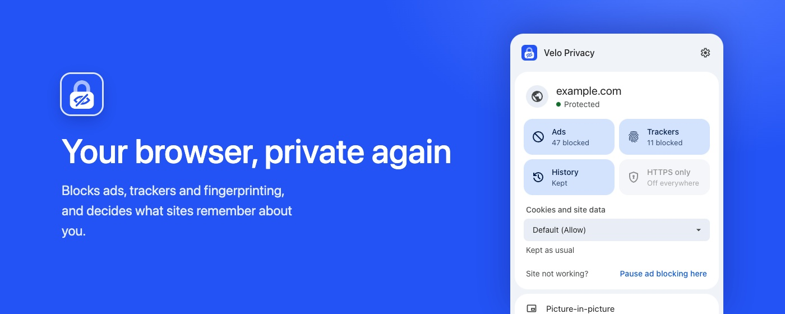
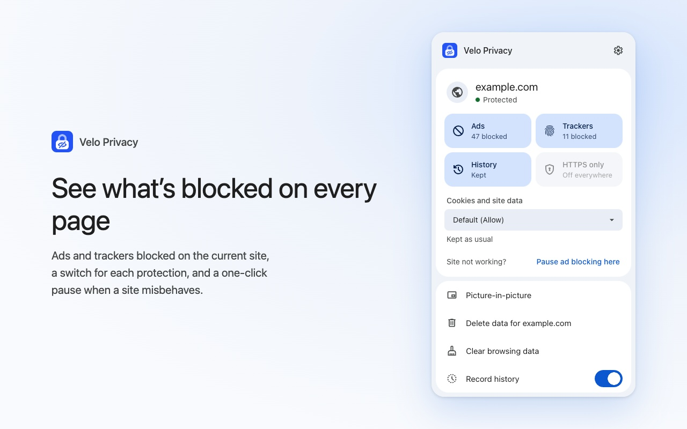
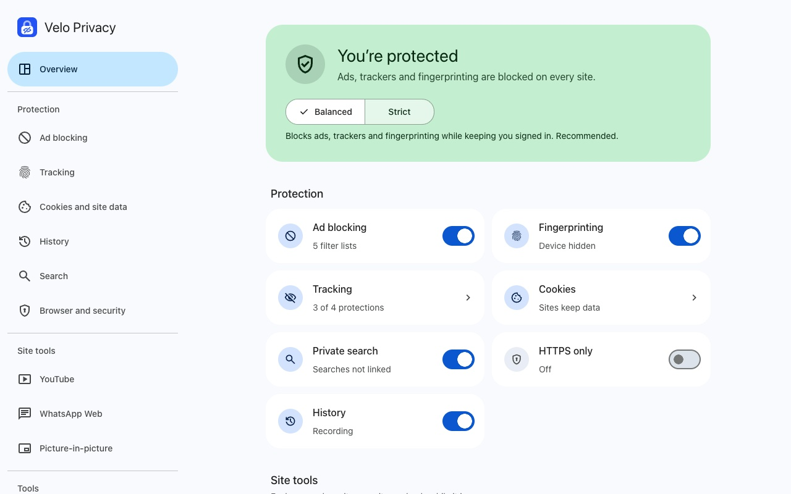
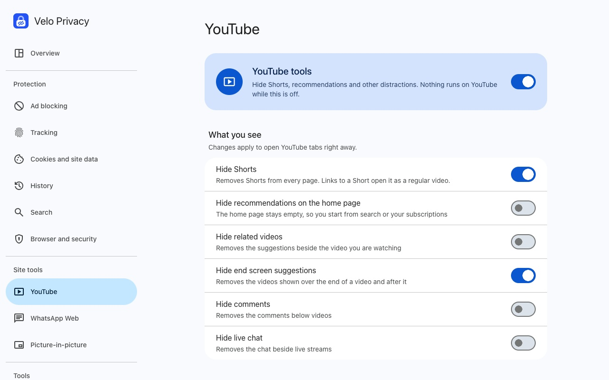
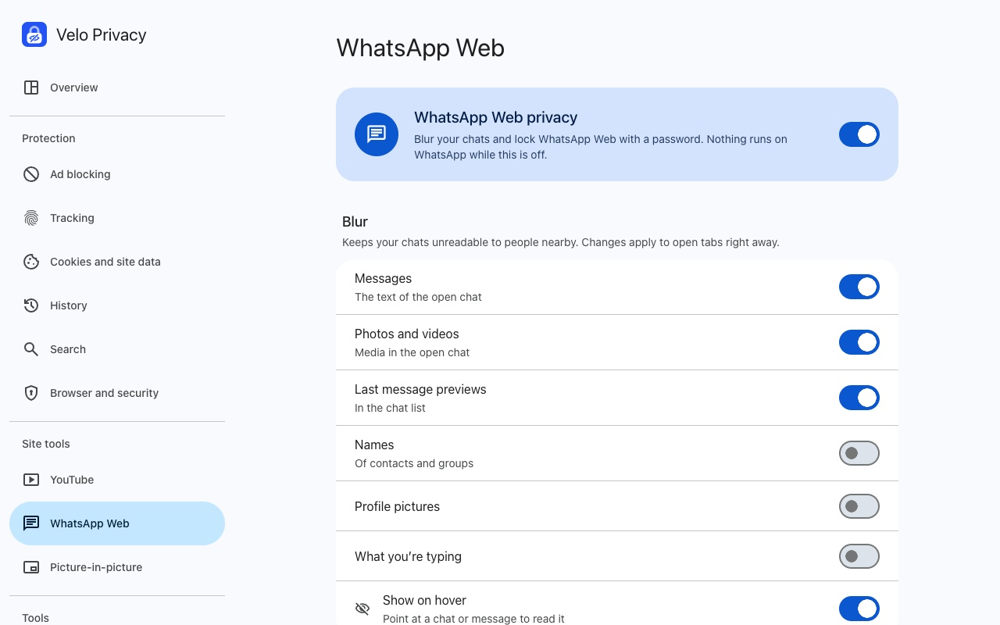
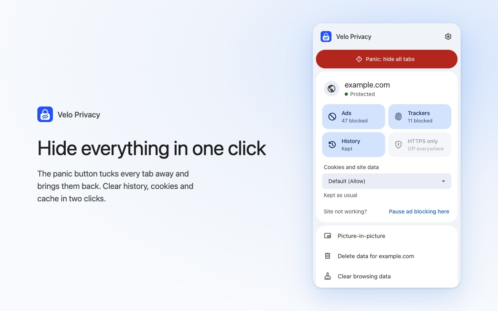

<div align="center">


# Velo Privacy

**Blocks ads, trackers and fingerprinting, and decides what websites and your browser remember about you.**

Fast, light, and private by design: no accounts, no analytics, no network requests of its own.

[](https://github.com/algodevX/Velo-Privacy/releases/latest)
[](https://github.com/algodevX/Velo-Privacy/actions/workflows/ci.yml)
[](LICENSE)

[**Download for Chrome, Edge, Brave, Opera**](https://github.com/algodevX/Velo-Privacy/releases/latest/download/velo-privacy-chromium.zip) ·
[**Download for Firefox**](https://github.com/algodevX/Velo-Privacy/releases/latest/download/velo-privacy-firefox.zip)



</div>

## At a glance

|                                                                                                                |                                                                                          |
| -------------------------------------------------------------------------------------------------------------- | ---------------------------------------------------------------------------------------- |
| **See what's blocked on every page.** One switch per protection, and a one-click pause when a site misbehaves. | **Everything on one screen.** Pick _Balanced_ or _Strict_, or fine-tune each protection. |
|                                                    |                           |
| **A calmer YouTube.** Hide Shorts, recommendations, comments and end screens.                                  | **WhatsApp Web, privately.** Blur chats and lock it with a password.                     |
|                                               |                   |
| **Panic button and cleanup.** Hide every tab in one click and clear browsing data fast.                        |                                                                                          |
|                                       |                                                                                          |

## Highlights

- 🛡️ **Ad and tracker blocking** with EasyList, EasyPrivacy, uBlock Origin and regional lists, on the browser's own fast blocking engine
- 🫥 **Fingerprinting protection** so sites can't recognise your device across visits
- 🍪 **Cookie control per site:** keep, delete on close, delete when you leave, or block
- 🔍 **Private search** on Google, Bing, DuckDuckGo, Startpage, Brave Search and more
- 🔒 **HTTPS only**, tracking-parameter removal and Global Privacy Control
- ▶️ **YouTube and WhatsApp Web tools** that cost nothing until you switch them on
- 🚨 **Panic button** (<kbd>Alt</kbd>+<kbd>Shift</kbd>+<kbd>H</kbd>) and quick browsing-data cleanup

## Install

1. Download the zip for your browser from the [latest release](https://github.com/algodevX/Velo-Privacy/releases/latest).
2. **Chrome, Edge, Brave, Opera, Vivaldi:** unzip `velo-privacy-chromium.zip`, open the
   extensions page (`chrome://extensions`), turn on **Developer mode**, choose **Load
   unpacked** and select the unzipped folder.
3. **Firefox:** open `about:debugging#/runtime/this-firefox`, choose **Load Temporary
   Add-on** and select `velo-privacy-firefox.zip`. Temporary add-ons are removed when
   Firefox restarts.

Store listings for the Chrome Web Store and Firefox Add-ons will be linked here once they
are live.

## Features in detail

**Cookies and site data.** Every site gets one of four behaviours: keep data, delete it
when the browser closes, delete it once you close the site's last tab, or never allow it.
Set a default, then override it per site from the toolbar button or with patterns such as
`example.com`, `google.*` or a regular expression. _Delete site data_ removes a site's
cookies, storage and history in one step.

**History.** Pause recording entirely, never keep particular sites, or never keep any page
whose address or title contains a keyword. Optionally delete history older than a set age
and clear finished downloads from the downloads list.

**Private search.** Searches on Google, Bing, DuckDuckGo, Startpage, Brave Search, Qwant,
Ecosia and Mojeek are sent without cookies, and the engines cannot set new ones, so each
search stands alone. Your browser history is untouched. Pick a region, language and
SafeSearch level once and Velo applies them on every supported engine, as URL parameters
that need no cookie. For example: Startpage, Germany, family filter off, on every search.

**Ad blocking.** EasyList, EasyPrivacy, the uBlock Origin lists and regional lists,
compiled into the browser's native request-blocking rules so pages get faster rather than
slower. Switch categories on and off (ads, trackers, cookie notices, social widgets,
annoyances), choose individual lists, write your own filters in Adblock Plus or uBlock
Origin syntax, and allow ads on sites you want to support.

**Fingerprinting protection.** Scripts that try to recognise your device from how it
draws graphics or plays sound get readings with invisible noise that changes on every
page load, and never learn the name of your graphics card.

**HTTPS only.** Optionally loads every page over an encrypted connection, with
exceptions for sites that have no HTTPS version. Off by default because, unlike the
browsers' own HTTPS-First modes, it cannot fall back to HTTP by itself.

**Tracking protection.** Removes click identifiers such as `utm_*`, `fbclid` and `gclid`
from links before the page loads, blocks link-auditing pings and beacons, can hide the
referrer from third parties, and sends Global Privacy Control.

**Browser settings.** Where the browser lets extensions manage them: block third-party
cookies, turn off ad measurement APIs (Topics, Protected Audience, Attribution Reporting),
hyperlink auditing, preloading and address-bar suggestions, and limit which IP addresses
WebRTC can reveal.

**Picture-in-picture.** Every video can use the browser's native picture-in-picture, even
on sites that switch it off. <kbd>Alt</kbd>+<kbd>P</kbd> pops out the main video of the
current tab.

**YouTube.** Hide Shorts, home page recommendations, related videos, end screens,
comments and live chat, each with its own switch, and play embedded videos from
youtube-nocookie.com.

**WhatsApp Web.** Blur messages, media, chat previews, names, profile pictures and what
you type, with hover to reveal and a shortcut to show everything. A password lock screen
can lock when WhatsApp opens or after a period of inactivity.

The site tools each have one master switch, off by default. While it is off nothing is
registered for that site, so they cost nothing until you use them.

**Panic button.** One click or <kbd>Alt</kbd>+<kbd>Shift</kbd>+<kbd>H</kbd> saves every
open tab to a bookmark folder and closes them, leaving one new tab. Pressing it again
reopens them and deletes the folder. Off by default; switching it on asks for the
bookmarks permission.

**Clear browsing data.** Delete history, cookies and site data, cache or download
history for a chosen time range, from the popup or the settings page, or jump to the
browser's own page for everything else.

**Toolbar popup.** Shows how many ads and trackers were blocked on the current page,
switches each protection for the site, and has a _Site not working?_ button that pauses
ad blocking there until you turn it back on.

**Protection levels.** _Balanced_ and _Strict_ set all the switches at once. Site lists,
keywords, filters and search preferences are never touched by a level, so you can switch
freely.

## Supported browsers

Velo is one Manifest V3 codebase built for three engines. Features whose browser APIs are
missing are switched off and hidden rather than failing.

| Browser                                    | Download          | Notes                                                                                                                  |
| ------------------------------------------ | ----------------- | ---------------------------------------------------------------------------------------------------------------------- |
| Chrome, Edge, Brave, Opera, Vivaldi (123+) | Chromium zip      | Everything. Cookie rules are enforced natively by the browser.                                                         |
| Firefox 128+                               | Firefox zip       | Cookie rules are enforced by removing cookies as they are set. Grant access to all sites when asked.                   |
| Safari 17+                                 | Build from source | No history or browser settings (Safari has no API for them). Deleting site data removes cookies but not other storage. |

The Chromium build is tested in the browser. The Firefox and Safari builds compile and
follow those browsers' documented APIs, but have not yet been tested in them.

If your browser has its own tracking protection, keep it on. Velo works alongside it, and
where both handle the same thing nothing is lost.

## Build from source

Requires Node.js 20 or later.

```sh
npm install
npm run build
```

The build writes one folder per browser into `dist/`, which is created by the build and
not stored in the repository.

**Chromium browsers:** open the extensions page (`chrome://extensions`, `edge://extensions`,
`brave://extensions`, …), turn on **Developer mode**, choose **Load unpacked** and select
`dist/chromium`.

**Firefox:** open `about:debugging#/runtime/this-firefox`, choose **Load Temporary
Add-on** and select `dist/firefox/manifest.json`.

**Safari:** convert the build into an Xcode project, then run it from Xcode:

```sh
xcrun safari-web-extension-converter dist/safari
```

For development, `npm run dev` rebuilds the Chromium version on every change; reload the
extension afterwards. Add `--refresh-filters` to a build to download the filter lists again
instead of using the cached copies from the last day.

## Permissions

| Permission              | Why Velo needs it                                                          |
| ----------------------- | -------------------------------------------------------------------------- |
| `declarativeNetRequest` | Block ads and trackers, rewrite search URLs, strip tracking parameters     |
| `cookies`               | Apply cookie rules and delete a site's cookies                             |
| `contentSettings`       | Enforce cookie rules natively (Chromium)                                   |
| `browsingData`          | Remove site storage and cache                                              |
| `history`               | Apply history rules and retention                                          |
| `downloads`             | Clear finished downloads from the list, if you turn it on                  |
| `privacy`               | Apply the browser settings you choose                                      |
| `scripting`             | Hide leftover ad space, fingerprinting protection, site tools, GPC, PiP    |
| `activeTab`             | Count what was blocked on the page whose popup you open                    |
| `bookmarks` (optional)  | Keep tabs hidden by the panic button; asked for only when you switch it on |
| `tabs`, `webNavigation` | Know which site each tab shows, for cleanup and per-site rules             |
| `favicon`               | Show site icons in your lists, read from the browser's cache (Chromium)    |
| `alarms`, `storage`     | Schedule history retention and store your settings                         |
| Access to all sites     | Required by the above to act on any site you choose                        |

Each build requests only the permissions its browser supports. Velo makes no network
requests of its own: filter lists are bundled at build time and settings stay in local
extension storage.

## Development

```sh
npm run check      # type-check, lint, format check and unit tests
npm test           # unit tests only
npm run format     # apply formatting
```

All decisions are pure functions in `src/shared`; browser APIs are confined to the
background script in `src/background`. See [CONTRIBUTING.md](CONTRIBUTING.md)
for conventions.

## Known limitations

- Browsers record a visit before extensions hear about it, so excluded pages exist in
  history for a few milliseconds. With history sync on, they may briefly reach other
  devices.
- Wildcard and regular-expression cookie rules take effect when a matching site is first
  opened.
- On engines that share their host with other services (Google, Bing), only search pages
  and suggestions are isolated, so you stay signed in to Maps or your account.
- Ad blocking runs on the browser's declarative rules, which cannot run scriptlets or
  procedural element filters. Filters that need them are skipped, as are regular
  expressions in the bundled lists. Your own filters are listed under _My filters_ when
  skipped, with the reason.
- Separate cookie jars per tab, like Firefox's containers, have no cross-browser API;
  the tab and session lifetimes cover most of the same need.
- Rules apply to regular windows. Private windows already discard everything on close.

## Credits

Ad blocking uses filter lists downloaded at build time and bundled with each release,
each under its own licence:

- [EasyList, EasyPrivacy, Fanboy's lists and the regional EasyLists](https://easylist.to/pages/licence.html): GPL-3.0 or CC BY-SA 3.0 (Cookie List: CC BY 3.0)
- [uBlock Origin filters](https://github.com/uBlockOrigin/uAssets): GPL-3.0
- [Liste FR](https://forums.lanik.us/): CC BY-SA 3.0

Interface icons are from [Material Symbols](https://github.com/google/material-design-icons)
by Google, under the Apache License 2.0.

## License

[GPL-3.0-or-later](LICENSE)
